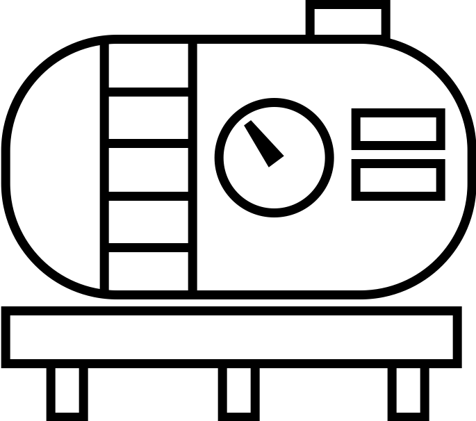

<!--
  ~ Licensed to the Apache Software Foundation (ASF) under one or more
  ~ contributor license agreements.  See the NOTICE file distributed with
  ~ this work for additional information regarding copyright ownership.
  ~ The ASF licenses this file to You under the Apache License, Version 2.0
  ~ (the "License"); you may not use this file except in compliance with
  ~ the License.  You may obtain a copy of the License at
  ~
  ~    http://www.apache.org/licenses/LICENSE-2.0
  ~
  ~ Unless required by applicable law or agreed to in writing, software
  ~ distributed under the License is distributed on an "AS IS" BASIS,
  ~ WITHOUT WARRANTIES OR CONDITIONS OF ANY KIND, either express or implied.
  ~ See the License for the specific language governing permissions and
  ~ limitations under the License.
  ~
  -->

## Machine Data Simulator

 
    

***

## Description

This adapter publishes simulated machine sensor data at a configurable time interval. It is ideal for exploring the
capabilities of StreamPipes without needing your own data or for testing purposes. The following scenarios are
available:

* Flowrate
* Pressure
* Water Level
* Diagnostics
* CNC Machining Centre
* Assembly Station
* Quality Test

All scenarios include an error or anomaly condition, making them suitable for trend detection, anomaly detection, and
similar applications: the simulation runs thirty seconds in normal mode and thirty seconds in alarm mode, alternating.
With `Number of sensors` greater than one, every event cycle produces one event per simulated machine, each with its own
`Sensor ID`.

### Flowrate Sensor

This scenario simulates a flowrate sensor in a piping system, including a sensor defect situation. The generated data
stream includes:

- **Sensor ID**: The identifier or name of the sensor, such as `sensor01`.
- **Mass Flow**: Numeric value denoting the current mass flow in the sensor, ranging from 0 to 10.
- **Volume Flow**: Numeric value denoting the current volume flow, ranging from 0 to 10.
- **Temperature**: Numeric value denoting the current temperature in degrees Celsius, ranging from 40 to 100.
- **Density**: Numeric value denoting the current density of the fluid, ranging from 40 to 50.
- **Sensor Fault Flags**: Boolean indicator of sensor issues.

The sensor defect scenario is as follows: Normally, temperature values range between 40 and 50 degrees Celsius. After
thirty seconds, the simulation switches to defect mode for another thirty seconds, with temperatures ranging from 80 to
100 degrees Celsius and `Sensor Fault Flags` set to `true`.

### Pressure Sensor

This scenario simulates a pressure sensor in a gas tank, including an anomaly situation. The generated data stream
includes:

- **Sensor ID**: The identifier or name of the sensor, such as `sensor01`.
- **Pressure**: Numeric value denoting the current pressure in the tank, ranging from 10 to 70.

The anomaly scenario is as follows: Normally, pressure values range between 10 and 40. After thirty seconds, the
simulation switches to anomaly mode for another thirty seconds, with pressure values ranging from 40 to 70.

### Water Level Sensor

This scenario simulates a sensor in a water tank, including an overflow situation. The generated data stream includes:

- **Sensor ID**: The identifier or name of the sensor, such as `sensor01`.
- **Level**: Numeric value denoting the current water level in the tank, ranging from 20 to 80.
- **Overflow**: Boolean indicator of tank overflow.

The overflow scenario is as follows: Normally, level values range between 20 and 30. After thirty seconds, the
simulation switches to overflow mode for another thirty seconds, with level values ranging from 60 to 80 and `Overflow`
set to `true`.

### CNC Machining Centre

This scenario simulates CNC machining centres that run a machining cycle: the part is loaded (10 seconds), roughed at
8000 rpm with a high spindle load (40 seconds) and finished at 12000 rpm with a low load (25 seconds). The tool wears
with every cutting second and is replaced in a 15-second tool change once its wear reaches 90 percent. The spindle
temperature follows the load with a lag, the vibration follows load and tool wear. The generated data stream includes:

- **Sensor ID**: The identifier of the machine, such as `cnc01`.
- **Program**: The NC program that is running, such as `GEARBOX-HOUSING-M3`.
- **Machine state**: `LOADING`, `RUNNING`, `TOOL_CHANGE` or `ALARM`.
- **Spindle speed**: Revolutions per minute, 0 while loading and 8000 or 12000 while cutting.
- **Spindle load**: Load in percent of the rated load, rising with tool wear.
- **Feed rate**: Feed in millimetres per minute, 0 while not cutting.
- **Spindle temperature**: Bearing temperature in degrees Celsius, drifting between about 25 and 60.
- **Tool wear**: Estimated wear of the active tool in percent, a saw-tooth over time.
- **Coolant flow**: Litres per minute, about 20 while cutting.
- **Vibration**: Vibration velocity in millimetres per second.
- **Parts completed**: Counter of finished parts.

In alarm mode the tool of one machine breaks (with several machines, the incidents rotate through them): the spindle
load jams at 100 percent, the feed is held, the vibration spikes above 10 millimetres per second, the machine state is
`ALARM` and the machine then performs a tool change.

### Assembly Station

This scenario simulates screwing stations on an assembly line. A station works on one part per cycle of about 45
seconds; the result of the last tightening (torque, angle, OK/NOK) stays on the station's tags until the next part is
done, as a PLC would report it. About three percent of the joints are NOK and are reworked in a shorter cycle. The
generated data stream includes:

- **Sensor ID**: The identifier of the station, such as `station01`.
- **Station state**: `LOADING`, `RUNNING` or `BLOCKED`.
- **Part ID**: Serial number of the part on the station, such as `GB-123456`.
- **Cycle progress**: Progress of the current cycle in percent.
- **Torque**: Final tightening torque of the last joint in newton metres, normally around 24 (specification 21 to 27).
- **Torque angle**: Rotation angle after the snug torque of the last joint in degrees, normally around 31.
- **Cycle time**: Duration of the last completed cycle in seconds.
- **Screw OK**: Boolean indicator whether the last joint is within specification.
- **Parts OK** and **Parts NOK**: Counters of joints within and outside the specification.

In alarm mode a bad batch of fasteners arrives: most joints end below 21 newton metres, the NOK counter climbs and
after three NOK joints in a row the station blocks the line (`BLOCKED`) until the alarm phase ends.

### Quality Test

This scenario simulates end-of-line leak test rigs. A rig loads a part (6 seconds), pressurises it to 3 bar (5
seconds) and holds the pressure for about 30 seconds while the pressure drop reveals the leak rate. The result of the
last part stays on the rig's tags until the next part is done. About three percent of the parts leak and fail. The
generated data stream includes:

- **Sensor ID**: The identifier of the test rig, such as `eol01`.
- **Test state**: `LOADING`, `PRESSURIZING` or `TESTING`.
- **Part ID**: Serial number of the part on the rig, such as `GB-123456`.
- **Test pressure**: Current pressure in the part in bar.
- **Leak rate**: Leak rate of the last tested part in millilitres per minute (limit 2).
- **Test duration**: Duration of the last test in seconds.
- **Passed**: Boolean indicator whether the last tested part passed.
- **Test result**: `PASS` or `FAIL`.
- **Parts tested** and **Parts failed**: Counters.

In alarm mode a bad batch of parts arrives and about 40 percent of them fail the test.

## Configuration

When creating the adapter, the following parameters can be configured:

- **Wait Time**: The time in milliseconds between two sensor events. Defaults to 1000 (1 second).
- **Number of sensors**: How many machines of the selected scenario to simulate. Defaults to 1.
- **Sensor**: Select one of the scenarios described above: `flowrate`, `pressure`, `waterlevel`, `diagnostics`,
  `cnc`, `assembly`, `quality`.

***